# SeeU diagrams

> Written by @Mr_Bingoo x Claude · "the author" below = @Mr_Bingoo
>
> The diagrams show "what's there and how it flows"; the docs explain "why, and which pitfalls we hit". The diagrams are written in Mermaid: change a line of text and the diagram follows, and GitHub renders them directly.
> Five kinds: ① overview (what it's made of) ② capability matrix (how far each scenario goes) ③ swimlane diagrams (for one step: who does what, how it decides, how it returns; one per action)
> ④ state diagrams (which states it can be in and how it switches) ⑤ mind map (all features at a glance).
> The diagrams only show SeeU's general approach; where a step was added because the author hit a problem in a real scenario, a short "Example:" paragraph under the diagram explains it.

> 💡 Diagrams marked "Windows preview" or "Linux preview" are for those systems (one overview and one capability matrix each; swimlanes 3.6 and 3.7 are Windows, 3.8 and 3.9 are Linux); all the others show the Mac version. For how Windows and Linux differ, see the [README](../README.en.md).

## ① Overview

**Mac**

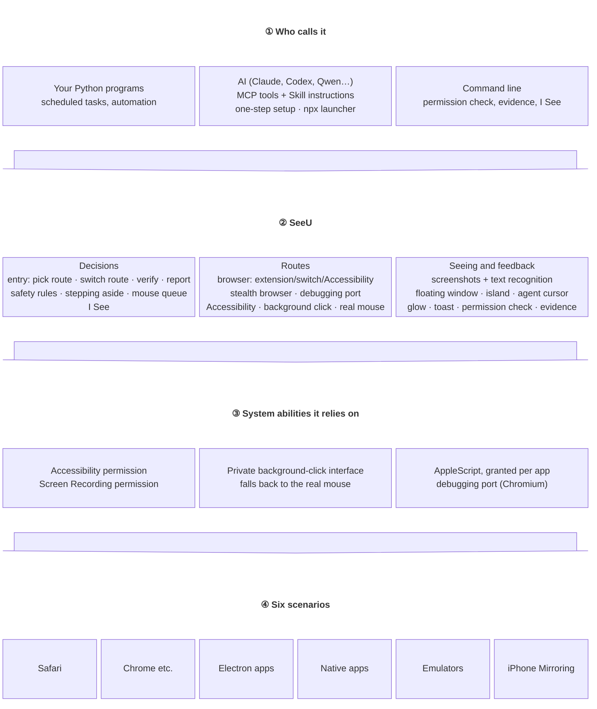

**Windows preview**

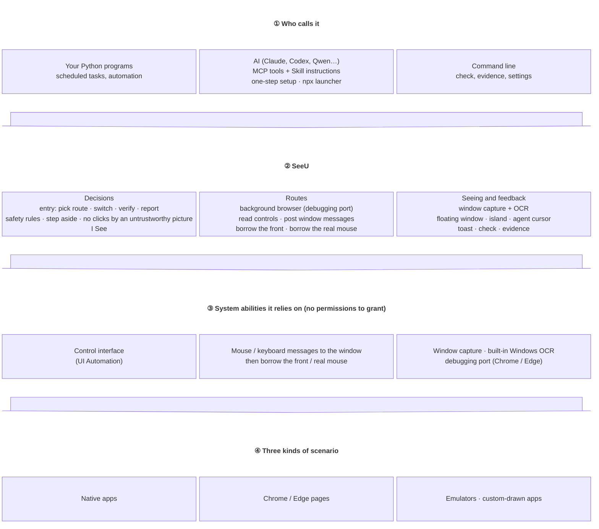

**Linux preview**

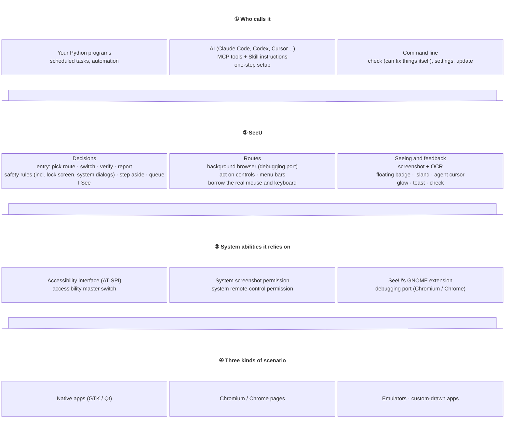

## ② Capability matrix

Legend: ✅ background, no disturbance · ⚡ briefly borrows the front window or your mouse · ⚠️ with conditions · ❌ not possible

**Mac**

| Scenario | Read content | Click | Type | Scroll | Works while hidden | Permissions needed |
|---|---|---|---|---|---|---|
| Safari | ✅ | ✅ | ✅ | ✅ | ✅ stealth Safari | Accessibility, the Safari switch (asks for your password), control of Safari |
| Chrome etc. | ✅ | ✅ | ✅ | ✅ | ✅ stealth Chrome (flashes 0.2–0.4 s at startup) | Accessibility, extension or switch; stealth Chrome uses the debugging port and needs nothing turned on |
| Electron apps (desktop software built with web tech; Electron, CEF and the like all count; e.g. VS Code) | ✅ SeeU's own copy; ⚠️ yours needs the window visible | ✅ SeeU's own copy; ⚠️ yours needs the window visible | ✅ SeeU's own copy; ⚠️ yours needs the window visible | ✅ SeeU's own copy; ⚠️ yours needs the window visible | ✅ SeeU's own copy; ❌ your own copy | None for SeeU's copy; yours needs Accessibility and Screen Recording |
| Native apps (Notes…) | ✅ | ✅ | ✅ | ✅ | ✅ (opening a specific note flashes briefly) | Accessibility; control of that app when AppleScript is used |
| Emulators (e.g. BlueStacks) | ✅ text recognition | ✅ background click (private interface) | ✅ | ✅ | ❌ (window must be there) | Accessibility, Screen Recording |
| iPhone Mirroring | ✅ text recognition | ✅ background click (private interface) | ✅ | ✅ (adds a small drag when stuck) | ❌ (window must be there, any size) | Accessibility, Screen Recording |
| Dragging (any scenario) | — | ⚡ borrows the real mouse | — | — | — | Same as above |

Every scenario goes through the safety rules first: Terminal, system permission prompts, the Privacy & Security part of System Settings, password apps (Keychain, Passwords, 1Password and so on), the AI client running SeeU itself (such as Claude or Codex), SeeU's own floating window buttons (so the AI can't turn on I See for itself), and dangerous shortcuts / commands / menu items are all blocked; password, verification-code and bank card fields are never touched. When opening apps in the background for Qwen, terminals, script apps, password apps, System Settings, browsers, other AI clients and remote-access apps are never opened.

"Background click (private interface)" = posting the click straight to the window through an interface macOS hasn't made public. It may stop working after a system update, and then SeeU automatically falls back to the real mouse (see 3.3).

For emulators we suggest ADB first (Android's official debugging tool, a public interface that doesn't go through SeeU): clicks, swipes and screenshots are fully in the background with accurate coordinates. SeeU fills in with background clicks, for example typing Chinese (ADB's built-in input only handles English letters and numbers) or when ADB isn't enabled in the emulator.

**Windows preview**

| Scenario | Read content | Click | Type | Scroll | Works while hidden | Permissions needed |
|---|---|---|---|---|---|---|
| Native apps (Notepad, File Explorer…) | ✅ reads controls | ✅ background click; ⚡ newer UI (e.g. the new Notepad's dialogs) briefly borrows the front | ✅ | ✅ | ⚠️ fine when covered by other windows; minimized windows can't be seen | None |
| Chrome / Edge pages (background browser) | ✅ | ✅ | ✅ | ✅ | ✅ never shows a window; shown only when you need to sign in yourself | None; only sites on the allow list |
| Your own Chrome or Electron apps (e.g. VS Code) | ✅ reads controls | ✅ background click | ✅ the input field must be named first | ✅ | ❌ when the window is covered, clicks don't reach the page (use the background browser for web pages) | None |
| Emulators, custom-drawn apps | ✅ text recognition | ✅ background click | ✅ | ✅ | ❌ (window must be there, not minimized) | None; OCR needs a Windows text-recognition language pack |
| Dragging (any scenario) | — | ✅ background first; ⚡ borrows the real mouse if that fails | — | — | — | — |

Three more things on Windows: windows running as administrator can't be touched (a Windows rule); when a window is on another virtual desktop, SeeU won't borrow your mouse or switch you over; when the picture can't be trusted (window covered, machine busy, another desktop), it won't click by a position on the screenshot, but clicks the control instead or asks the AI to look again.

**Linux preview**

| Scenario | Read content | Click | Type | Scroll | Works while hidden | Permissions needed |
|---|---|---|---|---|---|---|
| Native apps (Text Editor, FeatherPad…) | ✅ reads controls | ✅ acts on the control; ⚡ clicking by screen position borrows the real mouse | ✅ | ✅ where there's a scroll bar; ⚡ otherwise borrows the mouse | ⚠️ covered, minimized or on another workspace: clicking by number still works, but its picture can't be captured | Screenshot permission; Qt apps also need the accessibility master switch; clicking by screen position needs remote-control permission |
| Chromium / Chrome pages (background browser) | ✅ | ✅ | ✅ | ✅ | ✅ never shows a window; shown only when you need to sign in yourself | No permission, but install Chromium or Chrome first; only sites on the allow list |
| VS Code and other web-technology apps | ✅ reads controls (start VS Code with the accessibility flag) | ✅ acts on the control | ⚡ borrows the keyboard for a few seconds | ⚡ borrows the mouse | ❌ to borrow the keyboard or mouse the window must be on the current workspace, not minimized | Accessibility master switch, started with ACCESSIBILITY_ENABLED=1, remote-control permission |
| Your own browser (Firefox, Chrome…) | ✅ look only | ❌ | ❌ | ❌ | — | Not touched: it would bypass the allow list and carries your logins; web pages go through the background browser |
| Emulators, custom-drawn apps | ✅ text recognition (needs Tesseract) | ⚡ borrows the real mouse | ⚡ borrows the keyboard | ⚡ borrows the mouse | ❌ (window must be visible) | Screenshot and remote-control permissions |
| Long-press, dragging (any scenario) | — | ⚡ borrows the real mouse | — | — | — | Remote-control permission |

More things on Linux: only GNOME 45 or later is supported (Wayland recommended), and after SeeU's GNOME extension is installed or updated you need to log out and back in once; nothing happens while the screen is locked, and SeeU won't borrow your mouse or keyboard while a system dialog (password, authorization) is open; when clicking by screen position, it won't click if that point is covered by another window.

## ③ Swimlane diagrams

Each diagram has one column per module, with time running top to bottom. `alt` = a choice between branches, `opt` = only happens when the condition holds, `loop` = repeats (always with a limit).
The "Desktop feedback" column is what you see on screen; the glow depends on the floating window's "Light" setting: off / takeover (orange only while borrowing the mouse, default) / controlled (purple whenever it's operating).
The badge just says "SeeU", or "I See" while I See is on (a breathing dot = working); borrowing the mouse and getting stuck aren't shown by color: the floating window expands and says so.

### 3.1 Click a button (native app)

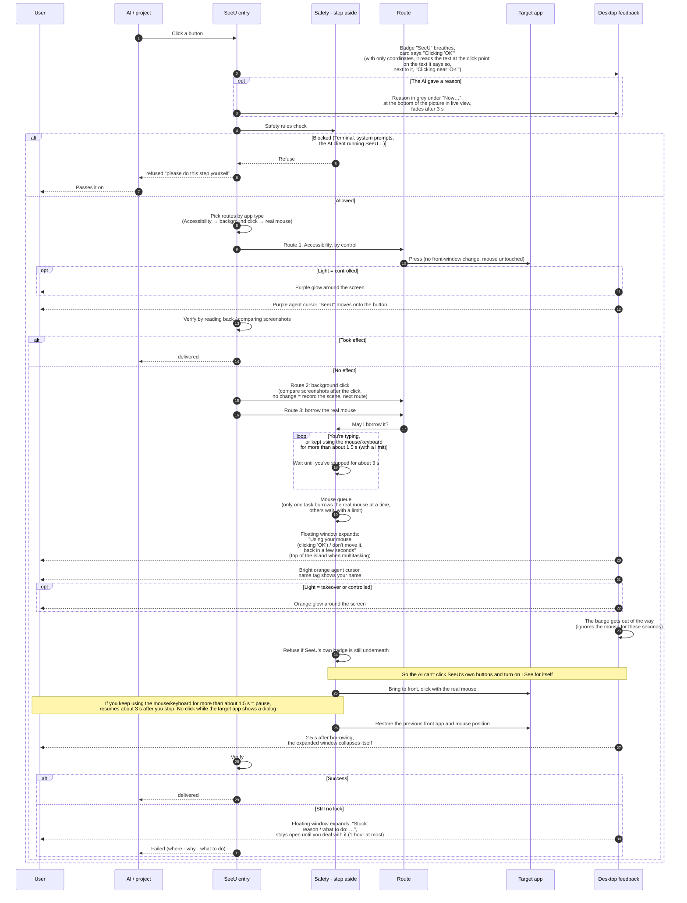

Whoever opens it closes it: a window that opened itself to say the mouse is being borrowed collapses by itself 2.5 s afterwards; a window you opened stays open until you collapse it, and while the mouse is borrowed it only shows the notice and then switches back. Getting stuck also opens the window by itself; it waits for you to collapse it, or goes back to normal when the AI carries on.
Fallback: after 60 s idle it shrinks to the badge, then fades after another 60 s; on Windows and Linux it simply disappears after 120 s idle. Stuck is the exception: the window stays open for up to 1 hour, and only then goes away like this.

**Several tasks at once**

- What SeeU does:
  - Only one task acts on the same app at a time (on Windows, the same window); after a step it keeps the app for a few seconds for its next step. The others queue for up to 30 seconds; if their turn doesn't come, the AI is told "busy, try again shortly" — nobody barges in. Several conversations in one AI client and different clients such as Claude and Codex all queue the same way.
  - Slow work such as typing a long passage keeps reporting "still working", so nobody cuts in; a step that was stopped because another task had just touched the app, so nothing was done, gives the app up right away.
  - If a click by position had to queue for more than 3 seconds and meanwhile the window moved or the picture near the click point changed, SeeU doesn't click and asks the AI to look again; if another task moved the focus in the same app, typing or a key press without a target field is skipped this time and the AI is asked to name the field (tapping the field and typing then happen in one go, with nobody in between).
  - Only one task borrows the real mouse at a time; the others queue. If a borrow had to wait, SeeU takes a fresh "before" picture after the wait, so a screen that changed by itself while waiting isn't mistaken for a successful click.
  - If a task exits unexpectedly without letting go, its claim expires after a while instead of blocking forever.
  - Each task has its own cursor, labeled with its conversation name (Claude, Claude2…) in its own color; a queued one dozes off (Zz) and fades. The island splits into two parts, with queued tasks below.
- Suggestions:
  - Stagger scheduled tasks, especially ones that borrow the mouse (dragging, clicks that don't land in the background);
  - Run mouse-heavy tasks when you're not using the computer;
  - Give SeeU a desktop of its own and work on another one, so you don't get in each other's way;
  - Use background routes wherever possible (ADB first for emulators, SeeU's own copy for Electron apps); the fewer mouse borrows the better.

Example: the author runs several automation projects at once (a phone app, an Android emulator, web form filling) and wrote a set of cross-project rules for them: who's using the mouse, who should give way, how scheduled tasks are staggered, how a crashed program's claim is taken over. The queue above is the smallest piece taken from those rules.

### 3.2 Typing

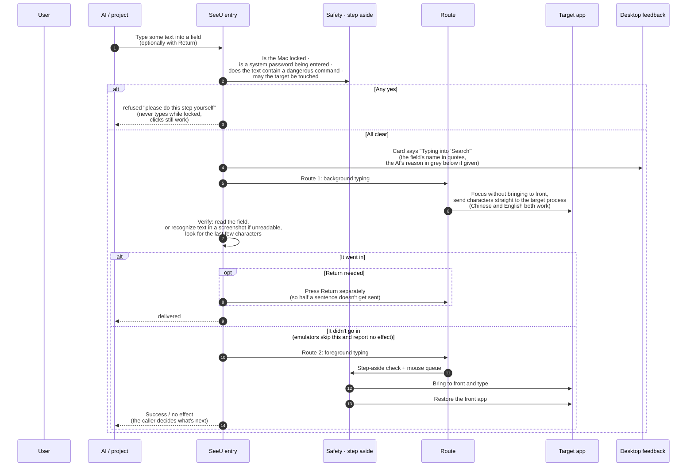

Example: when the author tested in BlueStacks (an Android emulator), text that wouldn't go in was caused by Android's input connection breaking, so even a real keyboard couldn't type; and with the window on another desktop, switching to the front just grabbed the front window for nothing. So emulators skip foreground typing and report no effect straight away.

### 3.3 iPhone Mirroring: background clicks and scrolling (private interface)

> **Highlight**: clicks and scrolling in Mirroring use macOS's unpublished SkyLight interface (`SLEventPostToPid`) to post events straight to the mirroring window: **your mouse doesn't move and the front window doesn't change**. This is what lets SeeU work truly in the background in iPhone Mirroring and emulators.
> **⚠️ Good to know up front**: ① a system update may change it → SeeU checks every time whether the interface is still there and goes straight to the real mouse if not; ② posted events come with no receipt, so there's no telling whether a click landed → it verifies by comparing screenshots, and if nothing changed it records the scene and falls back to the real mouse;
> ③ buttons are found by recognizing text in screenshots, which doesn't depend on this interface and keeps working if it breaks; ④ the approach was learned from the public code of the open-source project Cua; no closed-source program was reverse-engineered.

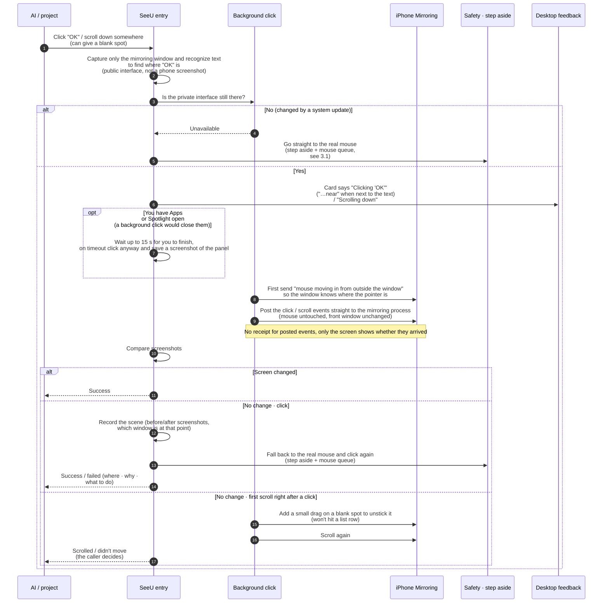

There's no background way to drag; it always borrows the real mouse (see 3.1).

Example: when the author used iPhone Mirroring on mini program pages inside an app (web pages embedded in the app), they found that after one background click, pop-up panels stopped scrolling; the "small drag" above was added for that, landing on blank space in the list so nothing gets clicked by mistake.
The author's own automation also needs the mirroring window fixed at 391×859, so it turns on the "fixed size" switch (`SEEU_BASELINE=1`); SeeU doesn't pin the size by default, and any window size works.

### 3.4 Stealth browser at work, then called out

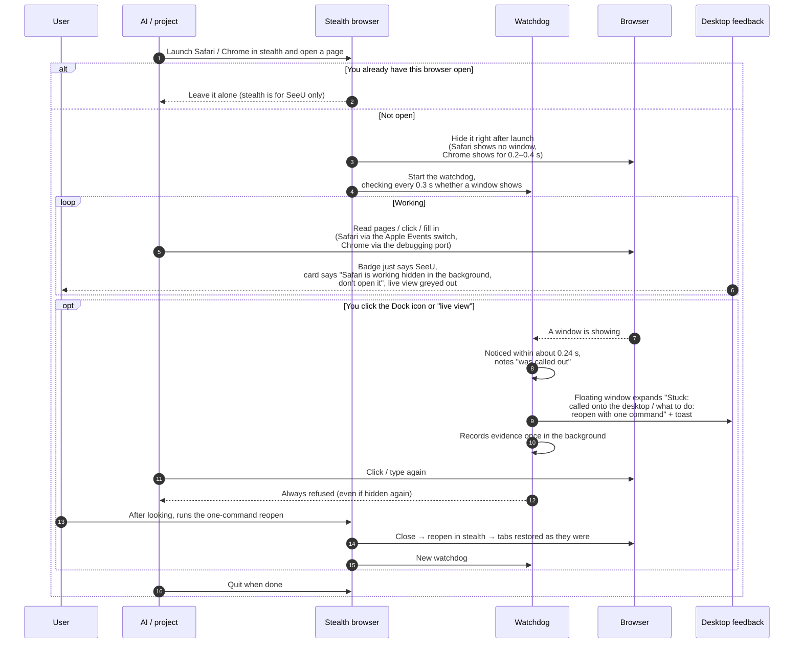

### 3.5 Electron app through the debugging port (VS Code as the example)

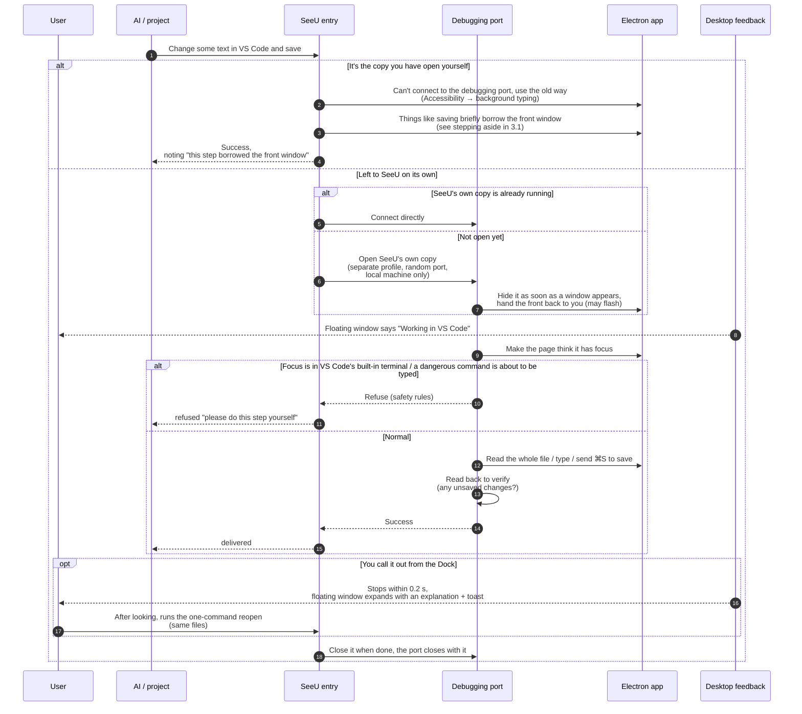

### 3.6 Windows preview: click a button

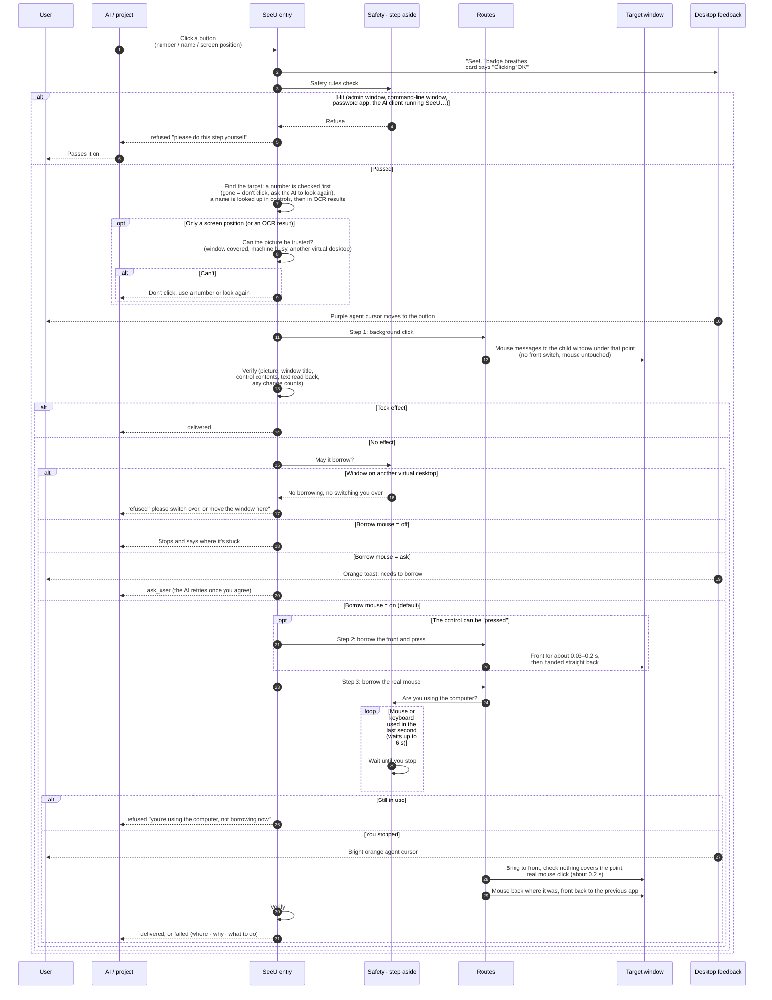

Main differences from the Mac (3.1): Windows has no private-interface step, background clicks are window messages; there's an extra "borrow the front and press" step, faster than the real mouse and without moving it; no system permissions to grant.

### 3.7 Windows preview: web pages through the background browser

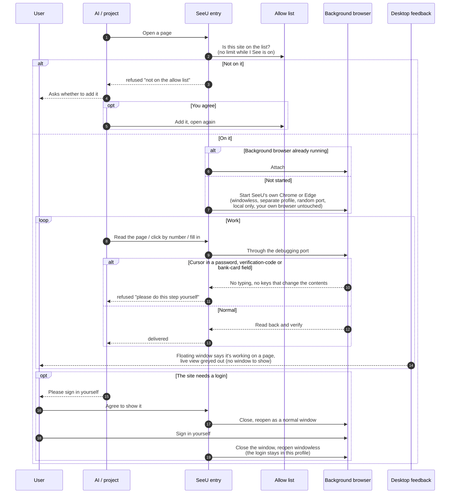

No long-press or dragging in browsers (both act by screen position and would bypass the allow list); things on a page are clicked by number only.

### 3.8 Linux preview: click a button, type into a field

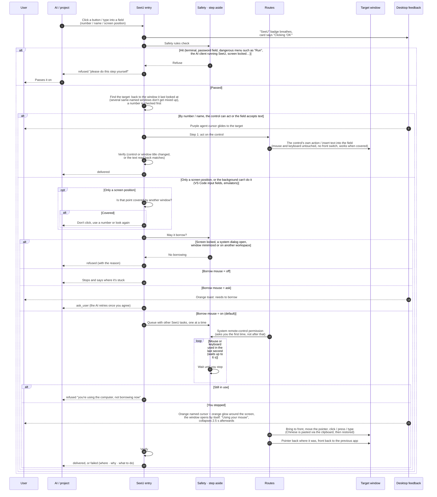

Main differences from Windows (3.6): on Linux the background has only one step, "act on the control" (no mouse messages to windows), so when that can't do it SeeU borrows the real mouse and keyboard; borrowing needs the system's remote-control permission; nothing is borrowed while the screen is locked or a system dialog is open.

### 3.9 Linux preview: web pages through the background browser

Same as Windows (3.7); only the browser differs: Linux uses Chromium or Chrome (the snap Chromium on Ubuntu works too). Your own browser is look-only for SeeU (tapping, typing, pressing keys and scrolling are refused), so web pages always go to this background browser.

## ④ State diagrams

### 4.1 Stealth browser

```mermaid
stateDiagram-v2
  NotOpen: Not open
  Hidden: Working hidden
  Out: Called out
  Stopped: Stopped
  [*] --> NotOpen
  NotOpen --> Hidden: Launch in stealth (left alone if you have it open)
  Hidden --> Hidden: Read / click / type
  Hidden --> Out: You click the Dock icon or live view
  Out --> Stopped: Noticed within about 0.24 s; window expands + toast + evidence
  Stopped --> Stopped: Any further action refused (even if hidden again)
  Stopped --> Hidden: You run the one-command reopen (tabs as they were)
  Hidden --> NotOpen: Quit when done
```

### 4.2 Floating window

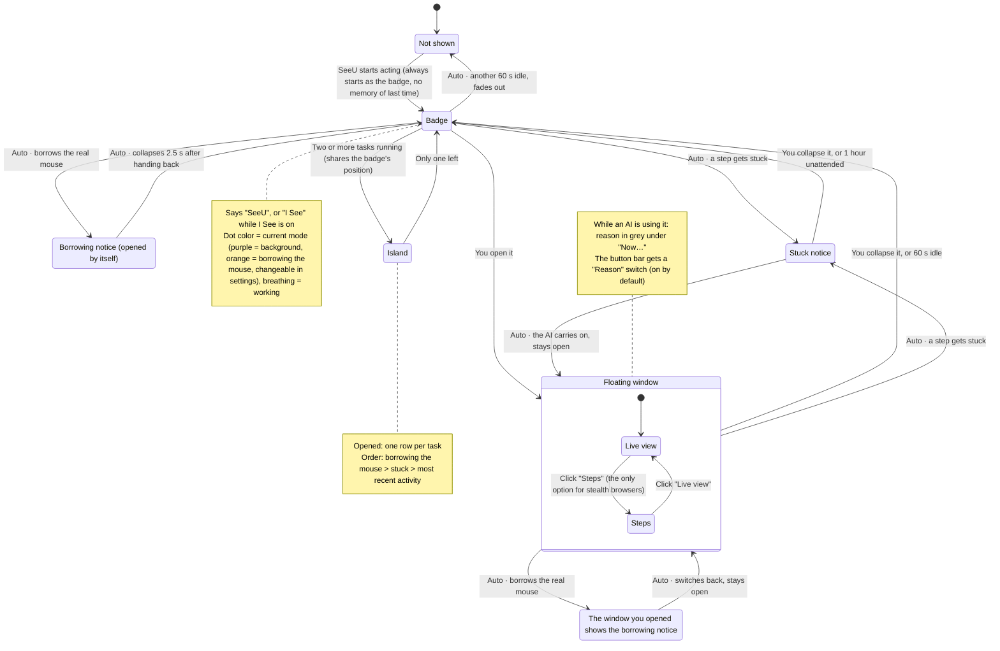

### 4.3 I See (I know the risks: authorized to act first)

```mermaid
stateDiagram-v2
  Off: Off
  On: On
  [*] --> Off
  Off --> On: You click the floating window button yourself (SeeU never clicks its own; the AI won't turn it on for you) / you turn it on from the command line
  On --> Off: You turn it off
  On --> Off: Turns off automatically after 24 h by default (reminds you if the browser's extra permission is still on)
  state On {
    Work: Working
    Try: Trying another way
    Skip: Skipped
    Halt: Stuck
    [*] --> Work
    Work --> Try: Hits a problem, doesn't stop to ask
    Try --> Work: Found a way (at most 3 routes / 60 s per spot)
    Try --> Skip: Can't do it, nothing later depends on it (noted, reported at the end)
    Skip --> Work
    Try --> Halt: Everything later depends on it (stops and reports at once)
  }
  note right of Off
    When off, anything it can't do is reported straight away:
    where it's stuck, why, what to do
    Web pages only; stepping aside, password fields and safety rules still apply when on
  end note
```

## ⑤ Mind map

Everything SeeU can do, in one picture.

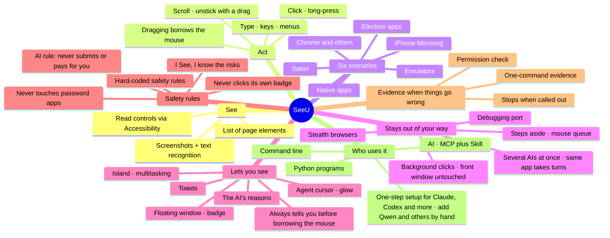
