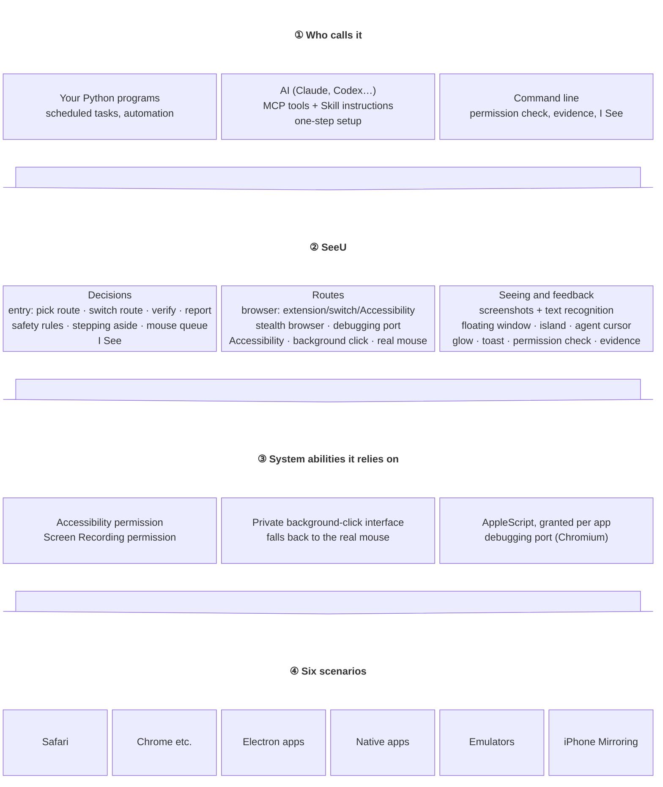
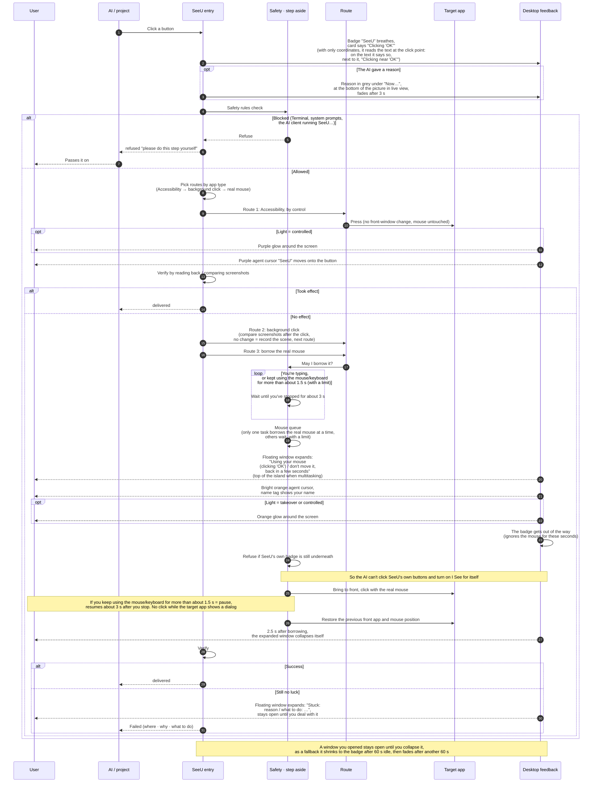
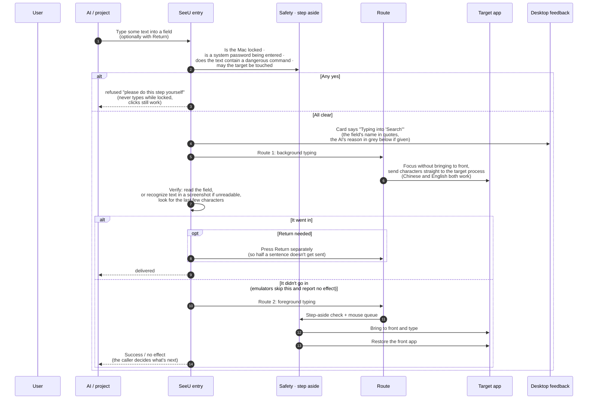
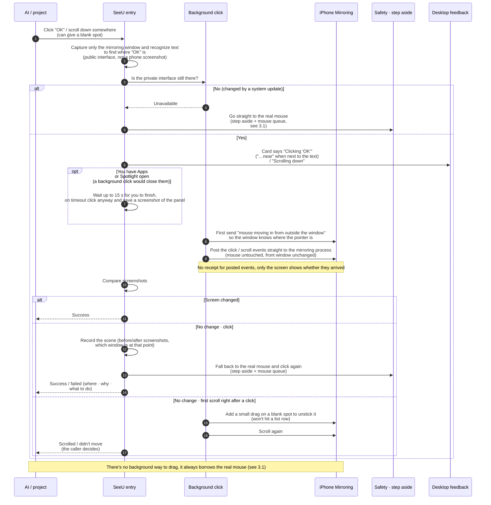
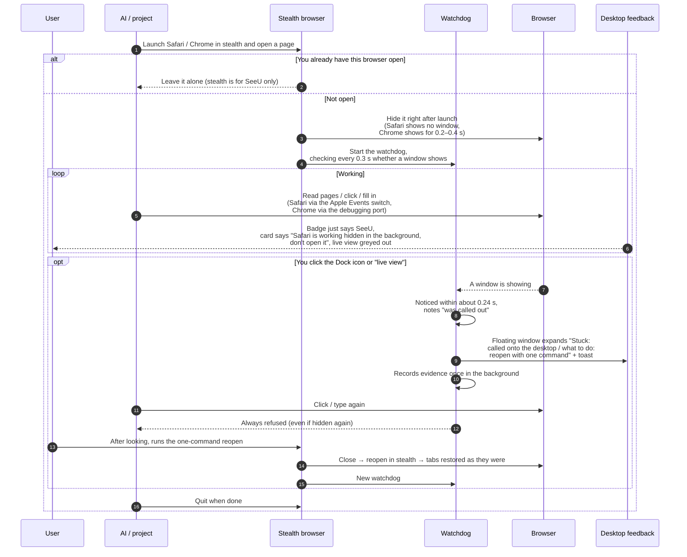
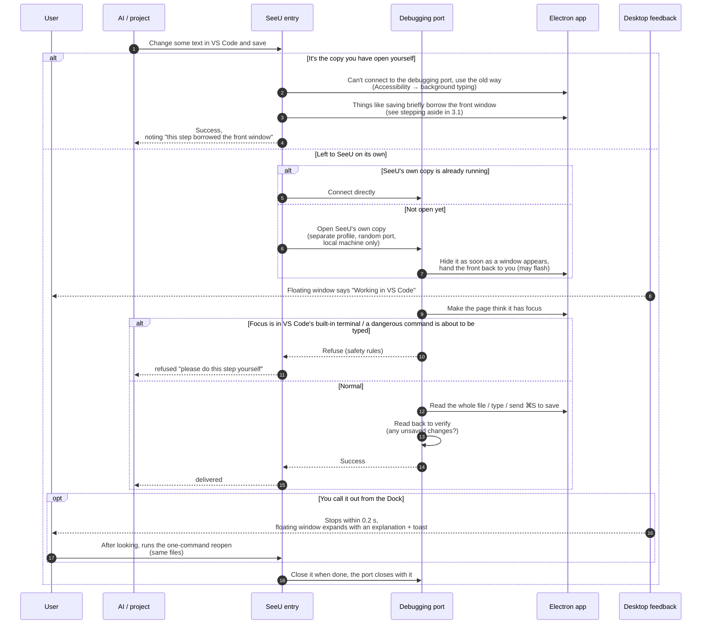
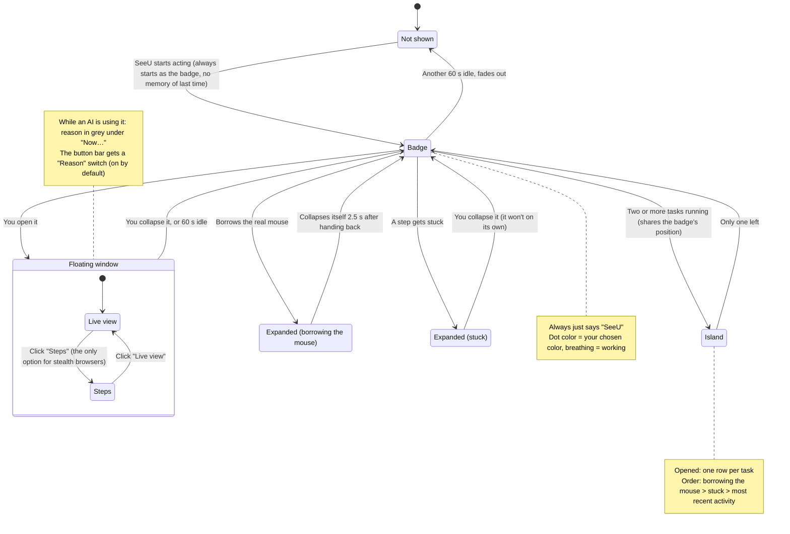
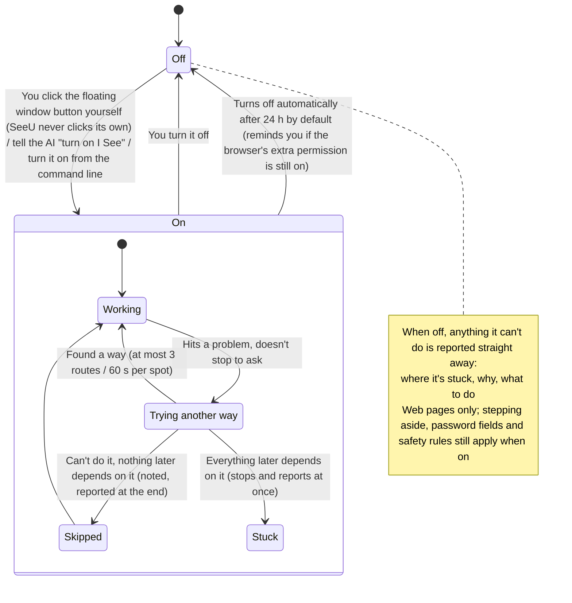
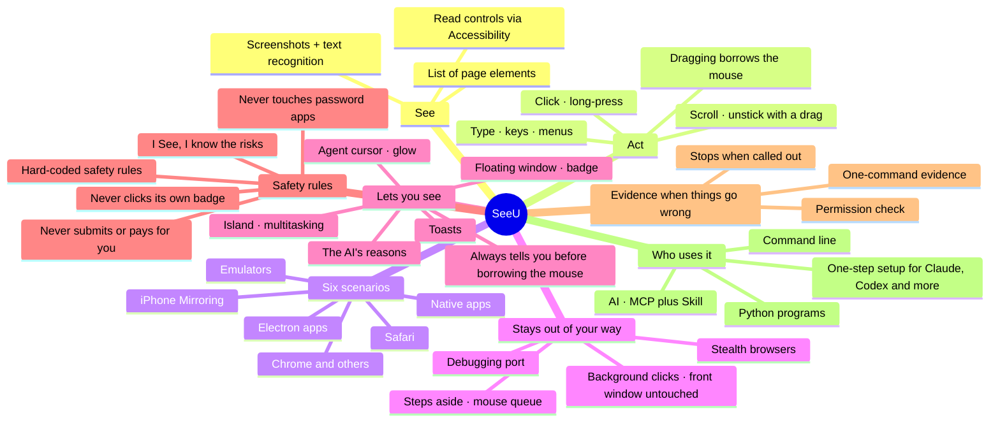

# SeeU diagrams

> Written by @Mr_Bingoo x Claude · "the author" below = @Mr_Bingoo
>
> The diagrams show "what's there and how it flows"; the docs explain "why, and which pitfalls we hit". The diagrams are written in Mermaid: change a line of text and the diagram follows, and GitHub renders them directly.
> Five kinds: ① overview (what it's made of) ② capability matrix (how far each scenario goes) ③ swimlane diagrams (for one step: who does what, how it decides, how it returns; one per action)
> ④ state diagrams (which states it can be in and how it switches) ⑤ mind map (all features at a glance).
> The diagrams only show SeeU's general approach; where a step was added because the author hit a problem in a real scenario, a short "Example:" paragraph under the diagram explains it.

## ① Overview

## ② Capability matrix

Legend: ✅ background, no disturbance · ⚡ briefly borrows the front window or your mouse · ⚠️ with conditions · ❌ not possible

| Scenario | Read content | Click | Type | Scroll | Works while hidden | Permissions needed |
|---|---|---|---|---|---|---|
| Safari | ✅ | ✅ | ✅ | ✅ | ✅ stealth Safari | Accessibility, the Safari switch (asks for your password), control of Safari |
| Chrome etc. | ✅ | ✅ | ✅ | ✅ | ✅ stealth Chrome (flashes 0.2–0.4 s at startup) | Accessibility, extension or switch; stealth Chrome uses the debugging port and needs nothing turned on |
| Electron apps (desktop software built with web tech; Electron, CEF and the like all count; e.g. VS Code) | ✅ SeeU's own copy; ⚠️ yours needs the window visible | ✅ SeeU's own copy; ⚠️ yours needs the window visible | ✅ SeeU's own copy; ⚠️ yours needs the window visible | ✅ SeeU's own copy; ⚠️ yours needs the window visible | ✅ SeeU's own copy; ❌ your own copy | None for SeeU's copy; yours needs Accessibility and Screen Recording |
| Native apps (Notes…) | ✅ | ✅ | ✅ | ✅ | ✅ (opening a specific note flashes briefly) | Accessibility; control of that app when AppleScript is used |
| Emulators (e.g. BlueStacks) | ✅ text recognition | ✅ background click (private interface) | ✅ | ✅ | ❌ (window must be there) | Accessibility, Screen Recording |
| iPhone Mirroring | ✅ text recognition | ✅ background click (private interface) | ✅ | ✅ (adds a small drag when stuck) | ❌ (window must be there, any size) | Accessibility, Screen Recording |
| Dragging (any scenario) | — | ⚡ borrows the real mouse | — | — | — | Same as above |

Every scenario goes through the safety rules first: Terminal, system permission prompts, the Privacy & Security part of System Settings, password apps (Keychain, Passwords, 1Password and so on), the AI client running SeeU itself (such as Claude or Codex), SeeU's own floating window buttons (so the AI can't turn on I See for itself), and dangerous shortcuts / commands / menu items are all blocked; password, CAPTCHA and bank card fields are never touched.

"Background click (private interface)" = posting the click straight to the window through an interface macOS hasn't made public. It may stop working after a system update, and then SeeU automatically falls back to the real mouse (see 3.3).

For emulators we suggest ADB first (Android's official debugging tool, a public interface that doesn't go through SeeU): clicks, swipes and screenshots are fully in the background with accurate coordinates. SeeU fills in with background clicks, for example typing Chinese (ADB's built-in input only handles English letters and numbers) or when ADB isn't enabled in the emulator.

## ③ Swimlane diagrams

Each diagram has one column per module, with time running top to bottom. `alt` = a choice between branches, `opt` = only happens when the condition holds, `loop` = repeats (always with a limit).
The "Desktop feedback" column is what you see on screen; the glow depends on the floating window's "Light" setting: off / takeover (orange only while borrowing the mouse, default) / controlled (purple whenever it's operating).
The badge always just says "SeeU" (a breathing dot = working); borrowing the mouse and getting stuck aren't shown by color: the floating window expands and says so.

### 3.1 Click a button (native app)

**Several tasks at once**

- What SeeU does: only one task borrows the real mouse at a time; the others queue. The wait has a limit, and if it runs out the task reports "stuck" rather than grabbing the mouse. If a task exits unexpectedly without letting go, its claim expires after a while instead of blocking forever.
- Suggestions:
  - Stagger scheduled tasks, especially ones that borrow the mouse (dragging, clicks that don't land in the background);
  - Run mouse-heavy tasks when you're not using the computer;
  - Give SeeU a desktop of its own and work on another one, so you don't get in each other's way;
  - Use background routes wherever possible (ADB first for emulators, SeeU's own copy for Electron apps); the fewer mouse borrows the better.

Example: the author runs several automation projects at once (a phone app, an Android emulator, web form filling) and wrote a set of cross-project rules for them: who's using the mouse, who should give way, how scheduled tasks are staggered, how a crashed program's claim is taken over. The queue above is the smallest piece taken from those rules.

### 3.2 Typing

Example: when the author tested in BlueStacks (an Android emulator), text that wouldn't go in was caused by Android's input connection breaking, so even a real keyboard couldn't type; and with the window on another desktop, switching to the front just grabbed the front window for nothing. So emulators skip foreground typing and report no effect straight away.

### 3.3 iPhone Mirroring: background clicks and scrolling (private interface)

> **Highlight**: clicks and scrolling in Mirroring use macOS's unpublished SkyLight interface (`SLEventPostToPid`) to post events straight to the mirroring window: **your mouse doesn't move and the front window doesn't change**. This is what lets SeeU work truly in the background in iPhone Mirroring and emulators.
> **⚠️ Good to know up front**: ① a system update may change it → SeeU checks every time whether the interface is still there and goes straight to the real mouse if not; ② posted events come with no receipt, so there's no telling whether a click landed → it verifies by comparing screenshots, and if nothing changed it records the scene and falls back to the real mouse;
> ③ buttons are found by recognizing text in screenshots, which doesn't depend on this interface and keeps working if it breaks; ④ the approach was learned from the public code of the open-source project Cua; no closed-source program was reverse-engineered.

Example: when the author used iPhone Mirroring on mini program pages inside an app (web pages embedded in the app), they found that after one background click, pop-up panels stopped scrolling; the "small drag" above was added for that, landing on blank space in the list so nothing gets clicked by mistake.
The author's own automation also needs the mirroring window fixed at 391×859, so it turns on the "fixed size" switch (`SEEU_BASELINE=1`); SeeU doesn't pin the size by default, and any window size works.

### 3.4 Stealth browser at work, then called out

### 3.5 Electron app through the debugging port (VS Code as the example)

## ④ State diagrams

### 4.1 Stealth browser

```mermaid
stateDiagram-v2
  NotOpen: Not open
  Hidden: Working hidden
  Out: Called out
  Stopped: Stopped
  [*] --> NotOpen
  NotOpen --> Hidden: Launch in stealth (left alone if you have it open)
  Hidden --> Hidden: Read / click / type
  Hidden --> Out: You click the Dock icon or live view
  Out --> Stopped: Noticed within about 0.24 s; window expands + toast + evidence
  Stopped --> Stopped: Any further action refused (even if hidden again)
  Stopped --> Hidden: You run the one-command reopen (tabs as they were)
  Hidden --> NotOpen: Quit when done
```

### 4.2 Floating window

### 4.3 I See (I know the risks: authorized to act first)

## ⑤ Mind map

Everything SeeU can do, in one picture.

