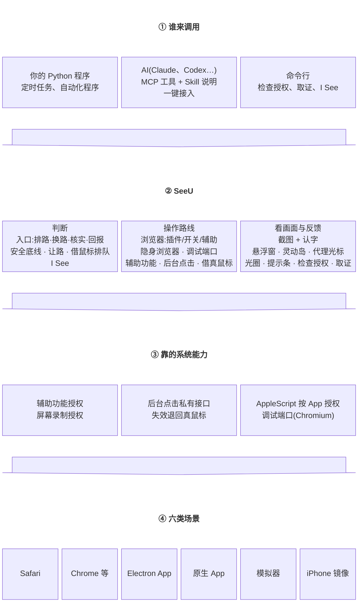
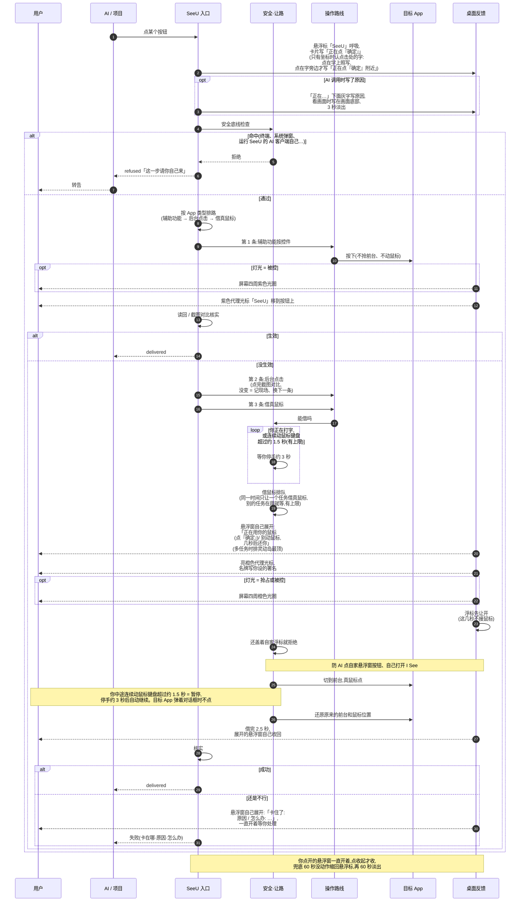
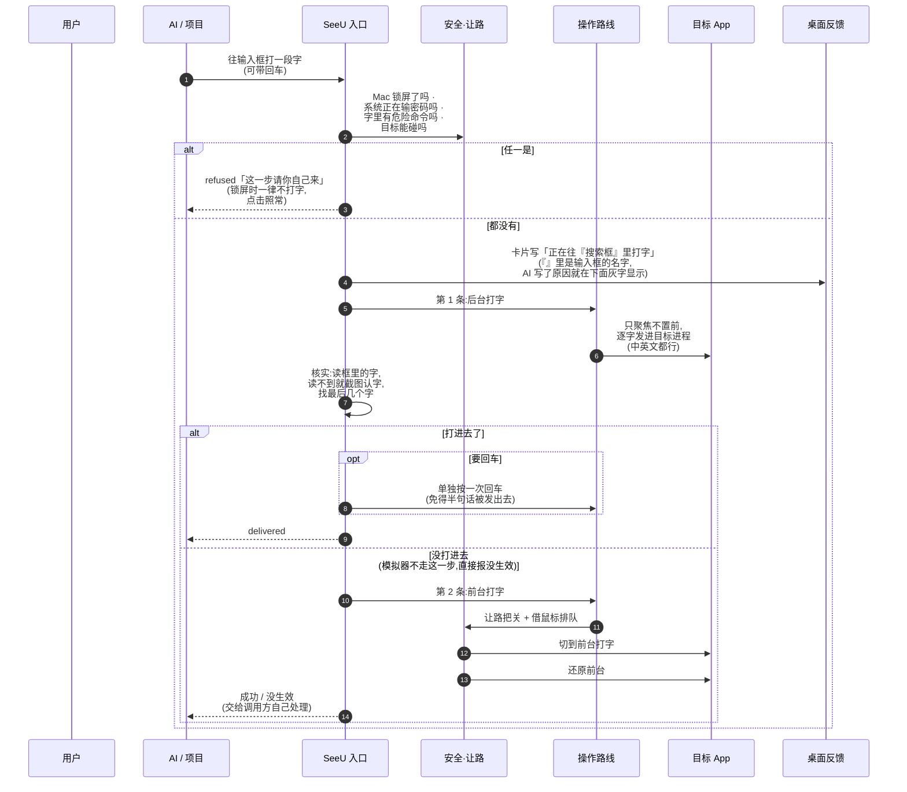
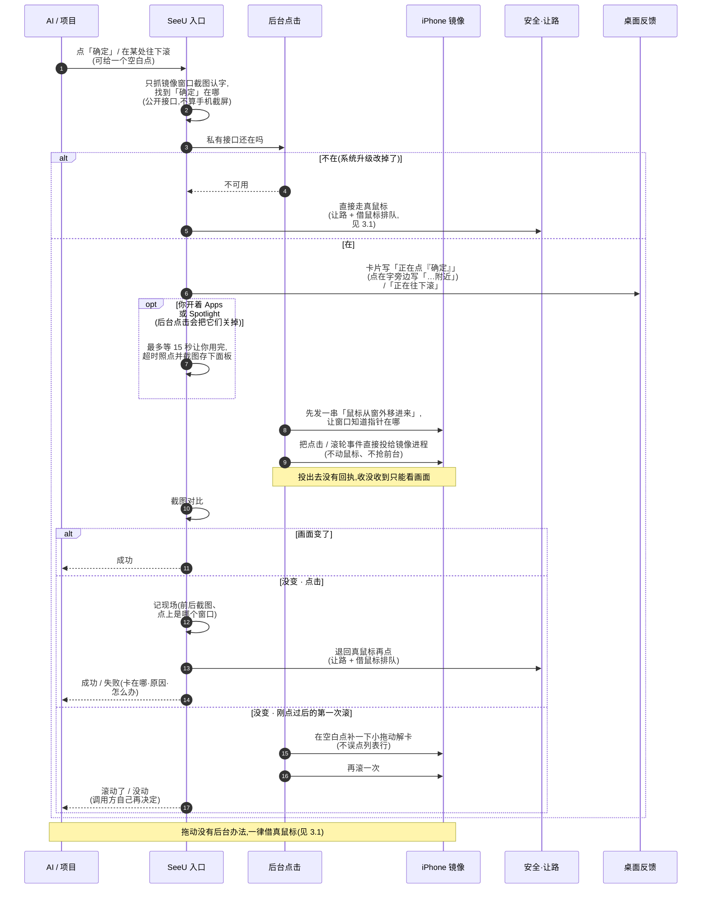
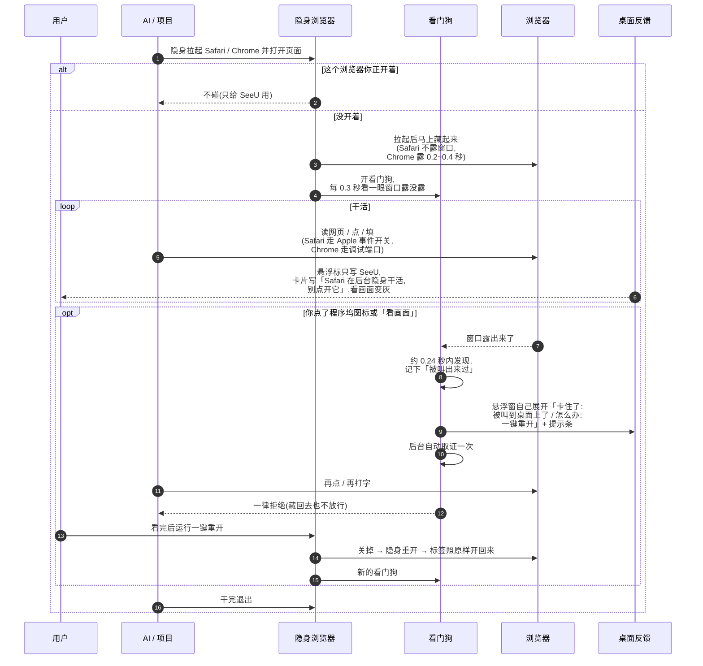
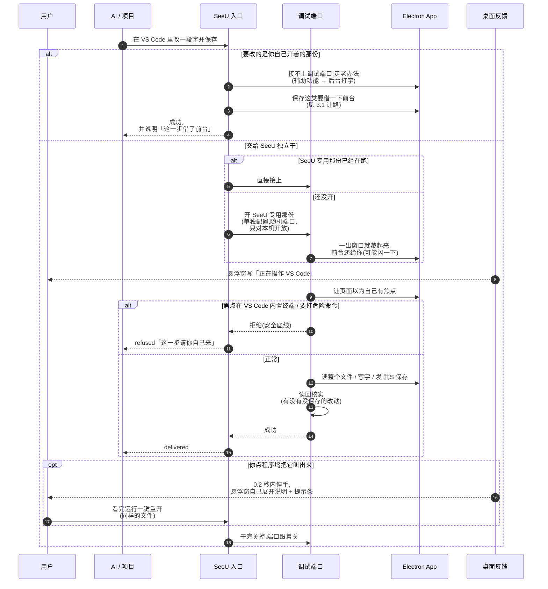
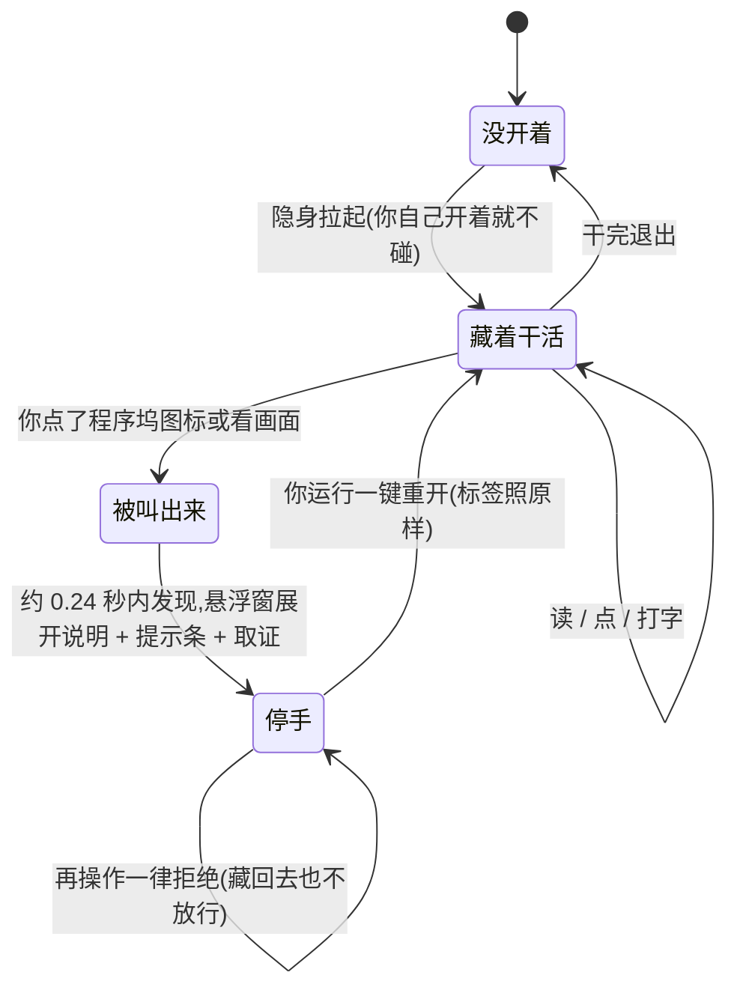
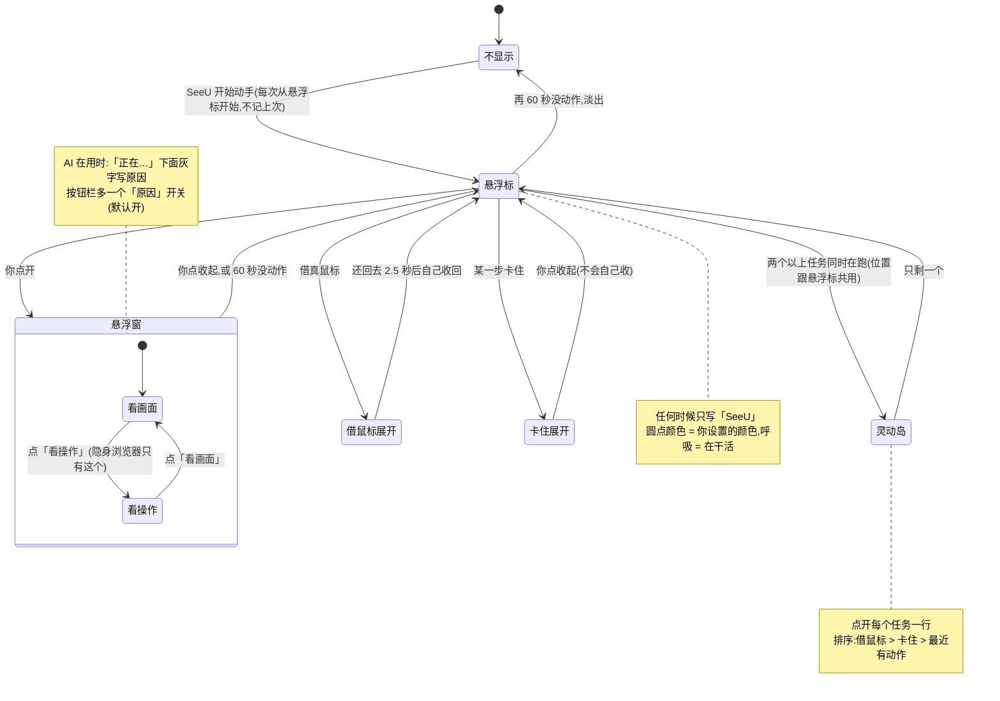
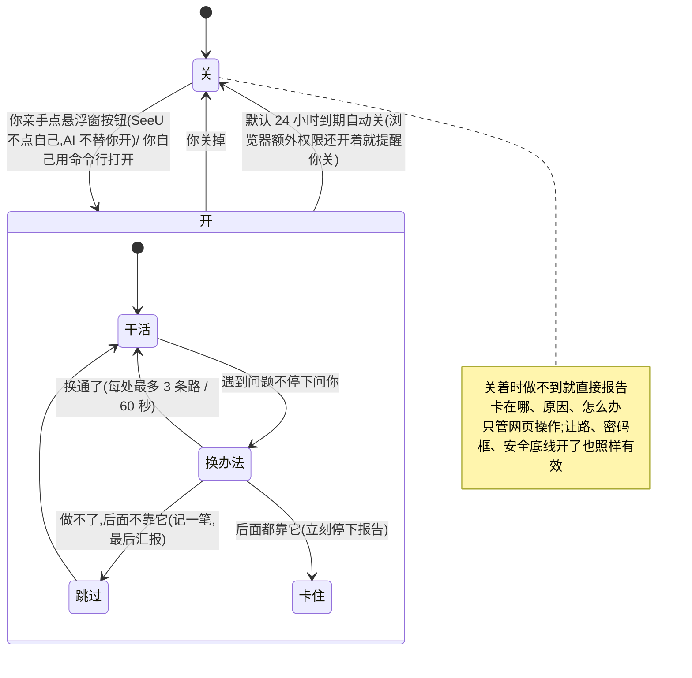
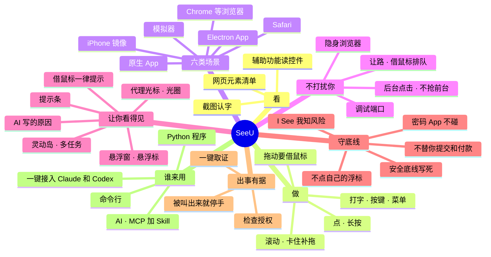

# SeeU 业务图

> 编写:@Mr_Bingoo x Claude · 文中「作者」= @Mr_Bingoo
>
> 用图讲「有什么、怎么走」,文档讲「为什么、踩过什么坑」。图用 Mermaid 写:改一行字图就跟着变,GitHub 能直接显示。
> 一共六种:① 全景图(由哪些部分组成)② 能力矩阵(每类场景能做到什么程度)③ 泳道图(做一步时谁做什么、怎么判断、怎么返回,每种动作一张)
> ④ 状态图(会处在哪些状态、怎么切换)⑤ 思维导图(功能全貌)。
> 图只画 SeeU 通用的做法;某一步是作者在实际场景里碰到问题才加的,图下面用「实例:」一小段说明场景。

## ① 全景图

## ② 能力矩阵

图例:✅ 后台,不打扰 · ⚡ 会借一下前台或你的鼠标 · ⚠️ 有条件 · ❌ 做不到

| 场景 | 读内容 | 点 | 打字 | 滚动 | 藏起来也能干活 | 操作所需的授权 |
|---|---|---|---|---|---|---|
| Safari | ✅ | ✅ | ✅ | ✅ | ✅ 隐身 Safari | 辅助功能、Safari 开关(要输密码)、控制 Safari |
| Chrome 等 | ✅ | ✅ | ✅ | ✅ | ✅ 隐身 Chrome(启动闪 0.2~0.4 秒) | 辅助功能、插件或开关;隐身 Chrome 走调试端口,什么都不用开 |
| Electron App(用网页技术做的桌面软件,Electron、CEF 等都算;如 VS Code) | ✅ SeeU 专用那份;⚠️ 你那份要窗口露着 | ✅ SeeU 专用那份;⚠️ 你那份要窗口露着 | ✅ SeeU 专用那份;⚠️ 你那份要窗口露着 | ✅ SeeU 专用那份;⚠️ 你那份要窗口露着 | ✅ SeeU 专用那份;❌ 你自己那份 | 专用那份不用;你那份要辅助功能、屏幕录制 |
| 原生 App(备忘录…) | ✅ | ✅ | ✅ | ✅ | ✅(「打开某一条备忘录」会闪一下) | 辅助功能;用 AppleScript 时控制该 App |
| 模拟器(如 BlueStacks) | ✅ 认字 | ✅ 后台点(私有接口) | ✅ | ✅ | ❌(窗口要在) | 辅助功能、屏幕录制 |
| iPhone 镜像 | ✅ 认字 | ✅ 后台点(私有接口) | ✅ | ✅(卡住会补小拖动) | ❌(窗口要在,大小不限) | 辅助功能、屏幕录制 |
| 拖动(任何场景) | — | ⚡ 借真鼠标 | — | — | — | 同上 |

所有场景都先过安全底线:终端、系统权限弹窗、系统设置的「隐私与安全性」、存密码的 App(钥匙串、密码、1Password 等)、运行 SeeU 的 AI 客户端自己(如 Claude、Codex)、SeeU 自己的悬浮窗按钮(防 AI 自己打开 I See)、危险快捷键 / 命令 / 菜单一律拦;密码框、验证码框、银行卡框不碰。

「后台点(私有接口)」= 用 macOS 没公开的接口把点击直接投给窗口,系统升级可能失效,失效自动退回真鼠标(见 3.3)。

模拟器建议优先用 ADB(安卓官方的调试工具,公开接口,不经过 SeeU):点击、滑动、截图都完全后台、坐标准;SeeU 用后台点击补充,比如打中文(ADB 自带输入只支持英文和数字)、模拟器没开 ADB 的时候。

## ③ 泳道图

每张图一列一个模块,从上往下是时间。`alt` = 二选一的判断,`opt` = 满足条件才发生,`loop` = 重复(都有上限)。
「桌面反馈」那一列是你在屏幕上看到的东西;光圈要看悬浮窗上的「灯光」档位:关 / 抢占(只在借鼠标时亮橙色,默认)/ 被控(只要在操作就亮紫色)。
悬浮标任何时候只写「SeeU」(圆点呼吸 = 在干活);借鼠标、卡住不靠颜色,悬浮窗自己展开写清楚。

### 3.1 点一个按钮(原生 App)

**多个任务同时跑**

- SeeU 怎么做:同一时间只让一个任务借真鼠标,别的任务排队等;等的时间有上限,等不到就报「卡住」,不会硬抢。某个任务意外退出没放手,过一会儿自动作废,不会一直占着。
- 建议:
  - 多个定时任务错开时间,尤其是要借鼠标的(拖动、后台点不进的);
  - 借鼠标多的任务安排在你不用电脑的时候跑;
  - 给 SeeU 单独留一个桌面,你在别的桌面干活,互不打扰;
  - 能走后台的都走后台(模拟器优先 ADB,Electron App 用 SeeU 单独打开的那份),借鼠标的次数越少越好。

实例:作者同时跑好几个自动化项目(手机 App、安卓模拟器、网页填表),为此自己写了一套跨项目的协作规则:谁在用鼠标、谁该让、定时任务怎么错开、程序崩了留下的占用怎么接管。上面的排队就是从这套规则里拿出来的最小部分。

### 3.2 打字

实例:作者在 BlueStacks(安卓模拟器)里测试时,打不进字是安卓里的输入连接断了,真键盘也打不进;窗口在别的桌面时切前台也只会白抢一次前台。所以模拟器不走前台打字,直接报没生效。

### 3.3 iPhone 镜像:后台点击和滚动(私有接口)

> **亮点**:镜像里点击、滚动用的是 macOS 没公开的 SkyLight 接口(`SLEventPostToPid`),把事件直接投给镜像窗口:**不动你的鼠标、不抢前台**。这是 SeeU 能在 iPhone 镜像、模拟器里真后台干活的关键。
> **⚠️ 提前知道**:① 系统升级可能改掉它 → 每次先查接口还在不在,不在就直接走真鼠标;② 投出去没有回执,不知道点没点进 → 靠截图对比核实,没变就记现场、退回真鼠标;
> ③ 找按钮靠截图认字,不依赖这个接口,失效了照常能用;④ 做法学自开源项目 Cua 的公开代码,不逆向任何闭源程序。

实例:作者用 iPhone 镜像操作某个 App 里的小程序页面(App 里内嵌的网页)时发现,后台点过一次之后,弹出面板会滚不动;上面「补一下小拖动」就是为它加的,落在列表空白处免得误点。
作者自己的自动化程序还要求镜像窗口固定成 391×859,所以打开了「固定尺寸」开关(`SEEU_BASELINE=1`);SeeU 默认不钉,窗口大小不限。

### 3.4 隐身浏览器干活,被叫出来

### 3.5 Electron App 走调试端口(以 VS Code 为例)

## ④ 状态图

### 4.1 隐身浏览器

### 4.2 悬浮窗

### 4.3 I See(我知风险,授权先做再说)

## ⑤ 思维导图

SeeU 能做的全部事情,一张图看完。

