# SeeU 业务图

> 编写:@Mr_Bingoo x Claude · 文中「作者」= @Mr_Bingoo
>
> 用图讲「有什么、怎么走」,文档讲「为什么、踩过什么坑」。图用 Mermaid 写:改一行字图就跟着变,GitHub 能直接显示。
> 一共五种:① 全景图(由哪些部分组成)② 能力矩阵(每类场景能做到什么程度)③ 泳道图(做一步时谁做什么、怎么判断、怎么返回,每种动作一张)
> ④ 状态图(会处在哪些状态、怎么切换)⑤ 思维导图(功能全貌)。
> 图只画 SeeU 通用的做法;某一步是作者在实际场景里碰到问题才加的,图下面用「实例:」一小段说明场景。

> 💡 标了「Windows 预览版」「Linux 预览版」的是这两个系统的图(全景图、能力矩阵各一份;泳道图 3.6、3.7 是 Windows,3.8、3.9 是 Linux);其余都按 Mac 版画,Windows 和 Linux 的差别见 [README](../README.md)。

## ① 全景图

**Mac 版**

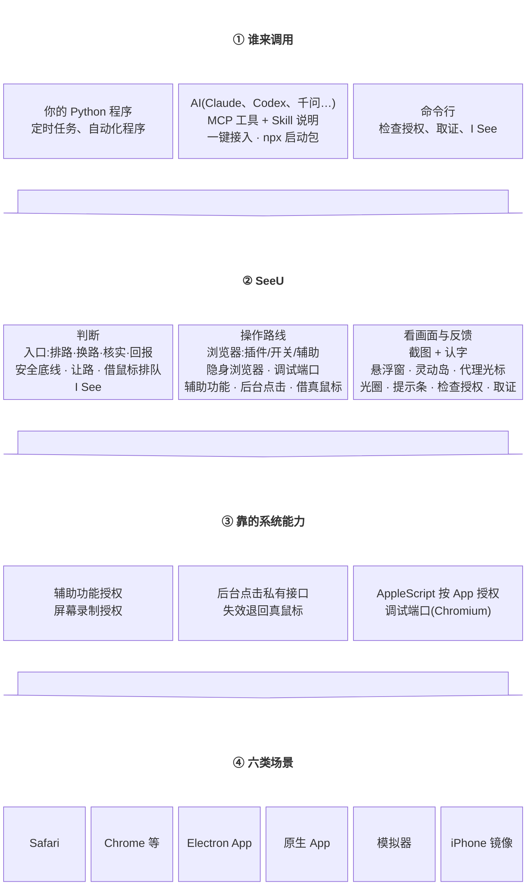

**Windows 预览版**

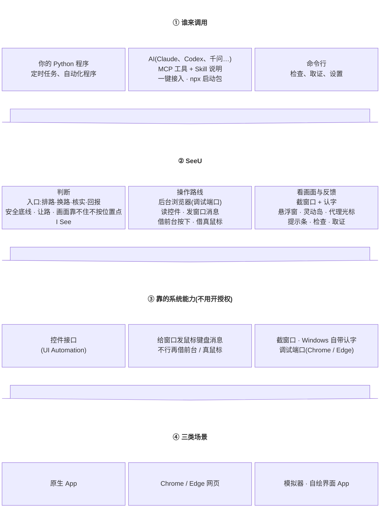

**Linux 预览版**

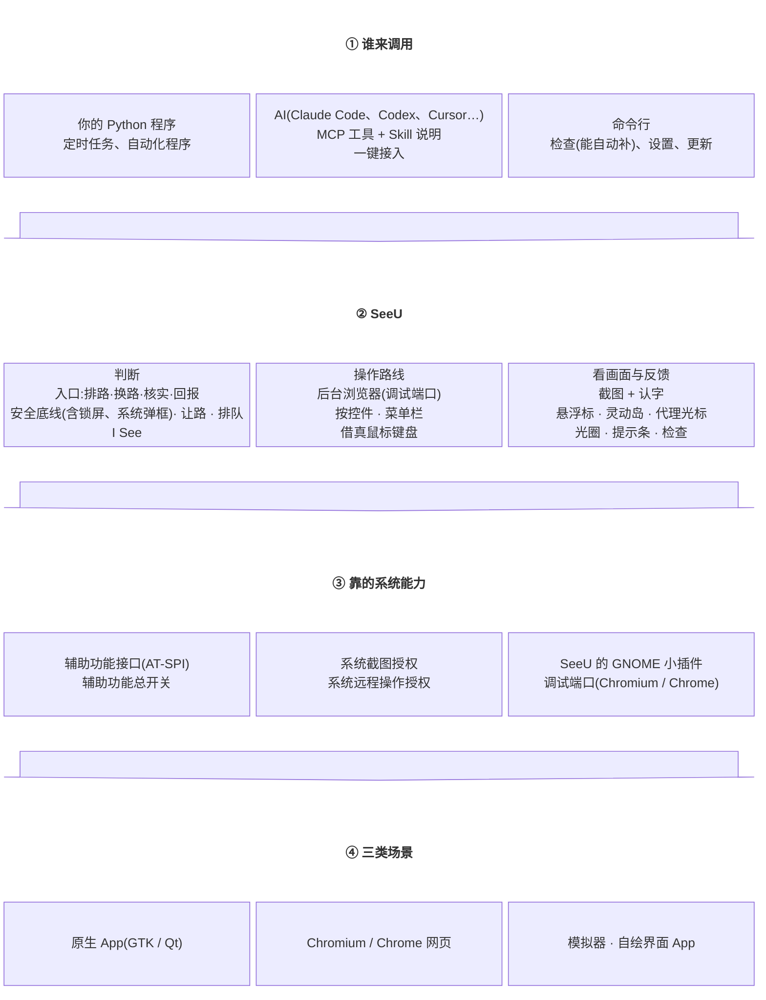

## ② 能力矩阵

图例:✅ 后台,不打扰 · ⚡ 会借一下前台或你的鼠标 · ⚠️ 有条件 · ❌ 做不到

**Mac 版**

| 场景 | 读内容 | 点 | 打字 | 滚动 | 藏起来也能干活 | 操作所需的授权 |
|---|---|---|---|---|---|---|
| Safari | ✅ | ✅ | ✅ | ✅ | ✅ 隐身 Safari | 辅助功能、Safari 开关(要输密码)、控制 Safari |
| Chrome 等 | ✅ | ✅ | ✅ | ✅ | ✅ 隐身 Chrome(启动闪 0.2~0.4 秒) | 辅助功能、插件或开关;隐身 Chrome 走调试端口,什么都不用开 |
| Electron App(用网页技术做的桌面软件,Electron、CEF 等都算;如 VS Code) | ✅ SeeU 单独打开的那份;⚠️ 你那份要窗口露着 | ✅ SeeU 单独打开的那份;⚠️ 你那份要窗口露着 | ✅ SeeU 单独打开的那份;⚠️ 你那份要窗口露着 | ✅ SeeU 单独打开的那份;⚠️ 你那份要窗口露着 | ✅ SeeU 单独打开的那份;❌ 你自己那份 | 单独打开的那份不用;你那份要辅助功能、屏幕录制 |
| 原生 App(备忘录…) | ✅ | ✅ | ✅ | ✅ | ✅(「打开某一条备忘录」会闪一下) | 辅助功能;用 AppleScript 时控制该 App |
| 模拟器(如 BlueStacks) | ✅ 认字 | ✅ 后台点(私有接口) | ✅ | ✅ | ❌(窗口要在) | 辅助功能、屏幕录制 |
| iPhone 镜像 | ✅ 认字 | ✅ 后台点(私有接口) | ✅ | ✅(卡住会补小拖动) | ❌(窗口要在,大小不限) | 辅助功能、屏幕录制 |
| 拖动(任何场景) | — | ⚡ 借真鼠标 | — | — | — | 同上 |

所有场景都先过安全底线:终端、系统权限弹窗、系统设置的「隐私与安全性」、存密码的 App(钥匙串、密码、1Password 等)、运行 SeeU 的 AI 客户端自己(如 Claude、Codex)、SeeU 自己的悬浮窗按钮(防 AI 自己打开 I See)、危险快捷键 / 命令 / 菜单一律拦;密码框、验证码框、银行卡框不碰。替千问后台打开 App 时,终端、能跑脚本的、存密码的、系统设置、浏览器、别的 AI 客户端和远程协助程序都不开。

「后台点(私有接口)」= 用 macOS 没公开的接口把点击直接投给窗口,系统升级可能失效,失效自动退回真鼠标(见 3.3)。

模拟器建议优先用 ADB(安卓官方的调试工具,公开接口,不经过 SeeU):点击、滑动、截图都完全后台、坐标准;SeeU 用后台点击补充,比如打中文(ADB 自带输入只支持英文和数字)、模拟器没开 ADB 的时候。

**Windows 预览版**

| 场景 | 读内容 | 点 | 打字 | 滚动 | 藏起来也能干活 | 操作所需的授权 |
|---|---|---|---|---|---|---|
| 原生 App(记事本、资源管理器…) | ✅ 读控件 | ✅ 后台点;⚡ 新式界面(如新版记事本的弹窗)借前台按一下 | ✅ | ✅ | ⚠️ 被别的窗口挡着行;最小化就看不到 | 不用 |
| Chrome / Edge 网页(后台浏览器) | ✅ | ✅ | ✅ | ✅ | ✅ 一直不出窗口;要登录时才叫出来让你自己登 | 不用;只碰允许名单里的网站 |
| 你自己开着的 Chrome、Electron App(如 VS Code) | ✅ 读控件 | ✅ 后台点 | ✅ 要先指定输入框 | ✅ | ❌ 窗口被挡着时网页里点不进(网页请用后台浏览器) | 不用 |
| 模拟器、自绘界面 App | ✅ 认字 | ✅ 后台点 | ✅ | ✅ | ❌(窗口要在,不能最小化) | 不用;认字要装 Windows 的文字识别语言包 |
| 拖动(任何场景) | — | ✅ 先试后台;⚡ 不行借真鼠标 | — | — | — | — |

Windows 上另外三条:以管理员身份运行的窗口碰不了(系统规定);窗口在别的虚拟桌面上时不借鼠标、不把你切过去;画面靠不住时(窗口被挡、机器很忙、在别的桌面)不照着截图上的位置点,改按控件点或请 AI 先再看一次。

**Linux 预览版**

| 场景 | 读内容 | 点 | 打字 | 滚动 | 藏起来也能干活 | 操作所需的授权 |
|---|---|---|---|---|---|---|
| 原生 App(文本编辑器、FeatherPad…) | ✅ 读控件 | ✅ 按控件点;⚡ 按屏幕位置点要借真鼠标 | ✅ | ✅ 有滚动条的;⚡ 没有的借鼠标 | ⚠️ 被挡着、最小化、在别的工作区也能按编号点,但截不到它的画面 | 辅助功能总开关、截图授权 |
| Chromium / Chrome 网页(后台浏览器) | ✅ | ✅ | ✅ | ✅ | ✅ 一直不出窗口;要登录时才叫出来让你自己登 | 不用;只碰允许名单里的网站 |
| VS Code 这类网页技术做的程序 | ✅ 读控件(VS Code 要带辅助功能参数启动) | ✅ 按控件点 | ⚡ 借键盘几秒 | ⚡ 借鼠标 | ❌ 要借键盘鼠标时,窗口得在当前工作区、没最小化 | 远程操作授权 |
| 你自己开着的浏览器(Firefox、Chrome…) | ✅ 只看 | ❌ | ❌ | ❌ | — | 不碰:会绕开允许名单、带着你的登录;网页走后台浏览器 |
| 模拟器、自绘界面 App | ✅ 认字(要装 Tesseract) | ⚡ 借真鼠标 | ⚡ 借键盘 | ⚡ 借鼠标 | ❌(窗口要露着) | 截图授权、远程操作授权 |
| 长按、拖动(任何场景) | — | ⚡ 借真鼠标 | — | — | — | 远程操作授权 |

Linux 上另外几条:只支持 GNOME 桌面(Wayland),SeeU 的 GNOME 小插件装上或更新后要注销重新登录一次;锁屏时什么都不做,系统弹框(输密码、授权)开着时不借你的鼠标键盘;按屏幕位置点时,那一点被别的窗口挡着就不点。

## ③ 泳道图

每张图一列一个模块,从上往下是时间。`alt` = 二选一的判断,`opt` = 满足条件才发生,`loop` = 重复(都有上限)。
「桌面反馈」那一列是你在屏幕上看到的东西;光圈要看悬浮窗上的「灯光」档位:关 / 抢占(只在借鼠标时亮橙色,默认)/ 被控(只要在操作就亮紫色)。
悬浮标平时只写「SeeU」,I See 开着时写「I See」(圆点呼吸 = 在干活);借鼠标、卡住不靠颜色,悬浮窗自己展开写清楚。

### 3.1 点一个按钮(原生 App)

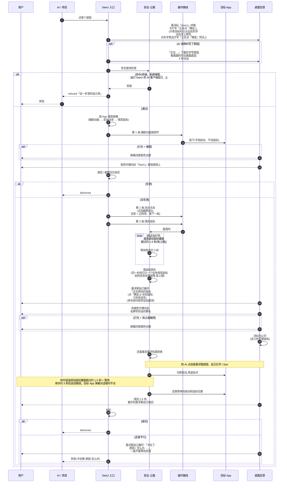

你点开的悬浮窗一直开着,点收起才收;兜底 60 秒没动作缩回悬浮标,再 60 秒淡出。

**多个任务同时跑**

- SeeU 怎么做:
  - 同一个 App(Windows 上是同一个窗口)一次只让一个任务动手,做完一步留几秒给它接着做下一步;别的任务排队,最多等 30 秒,等不到就告诉 AI「忙,稍后再试」,不会硬插队。同一个 AI 客户端里的几个会话、Claude 和 Codex 这类不同客户端,都按这个排。
  - 打一长段字这类慢活,做的过程中一直报「还在做」,别人插不进来;因为别的任务刚动过这个 App 而被拦下、什么都没做的那一步,马上让出。
  - 按位置点的那一步要是排队超过 3 秒才轮到,而这期间窗口挪了、或点的地方附近画面变了,就不点,先让 AI 重新看一眼;别的任务动过同一个 App 的焦点,不指定输入框的打字、按键这次不做,让 AI 指定输入框(点框和打字连着做完,中间不让人插进来)。
  - 同一时间只让一个任务借真鼠标,别的任务排队等;借之前要是等过,等完再拍一张「动作前」的画面来比,不会把等的时候画面自己变了当成点成了。
  - 某个任务意外退出没放手,过一会儿自动作废,不会一直占着。
  - 每个任务一只自己的光标,名牌写着是哪个会话(Claude、Claude2…),颜色各不相同,排队的那只打瞌睡(Zz)、变淡;灵动岛上分两段,下段是排队中的。
- 建议:
  - 多个定时任务错开时间,尤其是要借鼠标的(拖动、后台点不进的);
  - 借鼠标多的任务安排在你不用电脑的时候跑;
  - 给 SeeU 单独留一个桌面,你在别的桌面干活,互不打扰;
  - 能走后台的都走后台(模拟器优先 ADB,Electron App 用 SeeU 单独打开的那份),借鼠标的次数越少越好。

实例:作者同时跑好几个自动化项目(手机 App、安卓模拟器、网页填表),为此自己写了一套跨项目的协作规则:谁在用鼠标、谁该让、定时任务怎么错开、程序崩了留下的占用怎么接管。上面的排队就是从这套规则里拿出来的最小部分。

### 3.2 打字

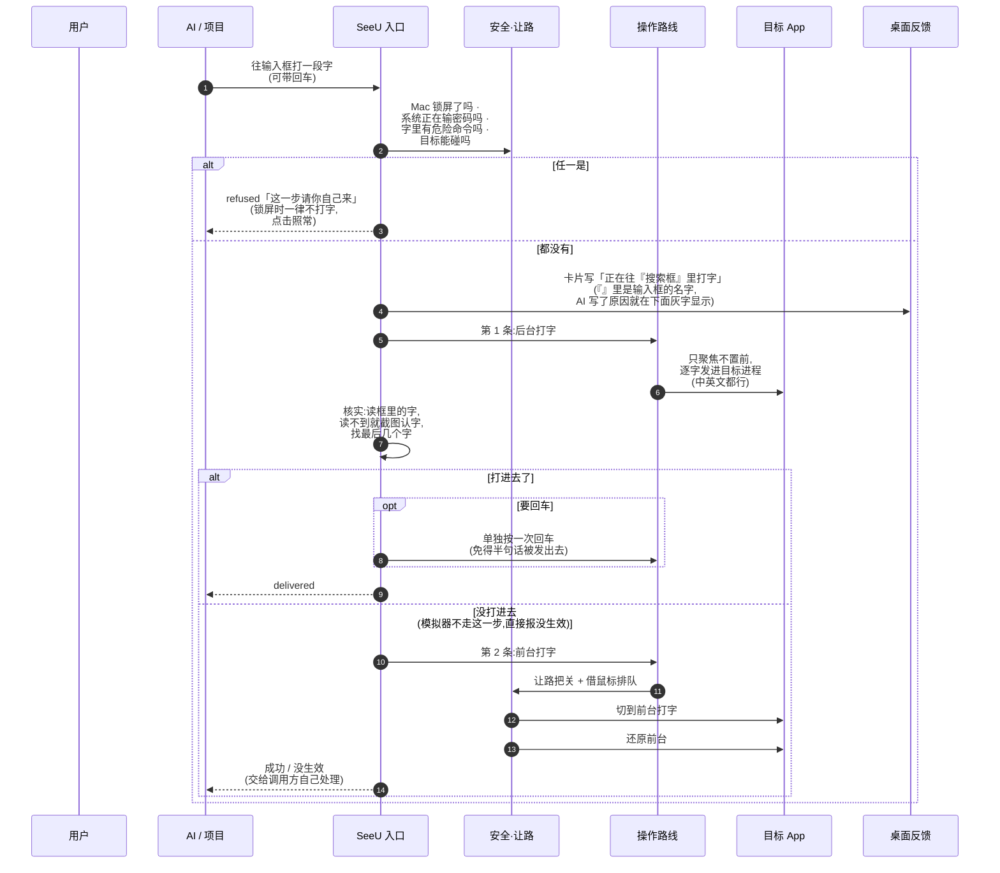

实例:作者在 BlueStacks(安卓模拟器)里测试时,打不进字是安卓里的输入连接断了,真键盘也打不进;窗口在别的桌面时切前台也只会白抢一次前台。所以模拟器不走前台打字,直接报没生效。

### 3.3 iPhone 镜像:后台点击和滚动(私有接口)

> **亮点**:镜像里点击、滚动用的是 macOS 没公开的 SkyLight 接口(`SLEventPostToPid`),把事件直接投给镜像窗口:**不动你的鼠标、不抢前台**。这是 SeeU 能在 iPhone 镜像、模拟器里真后台干活的关键。
> **⚠️ 提前知道**:① 系统升级可能改掉它 → 每次先查接口还在不在,不在就直接走真鼠标;② 投出去没有回执,不知道点没点进 → 靠截图对比核实,没变就记现场、退回真鼠标;
> ③ 找按钮靠截图认字,不依赖这个接口,失效了照常能用;④ 做法学自开源项目 Cua 的公开代码,不逆向任何闭源程序。

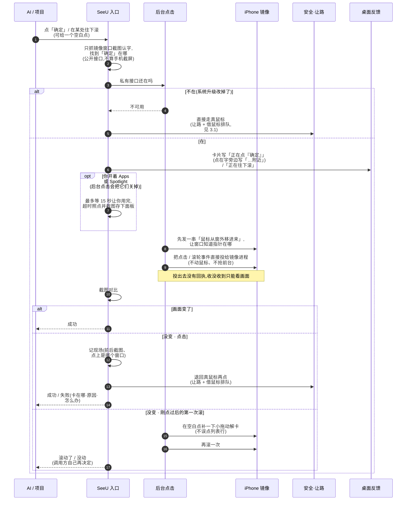

拖动没有后台办法,一律借真鼠标(见 3.1)。

实例:作者用 iPhone 镜像操作某个 App 里的小程序页面(App 里内嵌的网页)时发现,后台点过一次之后,弹出面板会滚不动;上面「补一下小拖动」就是为它加的,落在列表空白处免得误点。
作者自己的自动化程序还要求镜像窗口固定成 391×859,所以打开了「固定尺寸」开关(`SEEU_BASELINE=1`);SeeU 默认不钉,窗口大小不限。

### 3.4 隐身浏览器干活,被叫出来

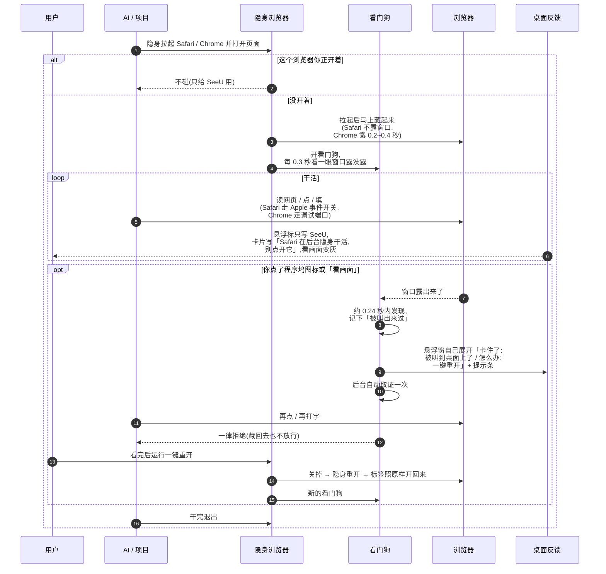

### 3.5 Electron App 走调试端口(以 VS Code 为例)

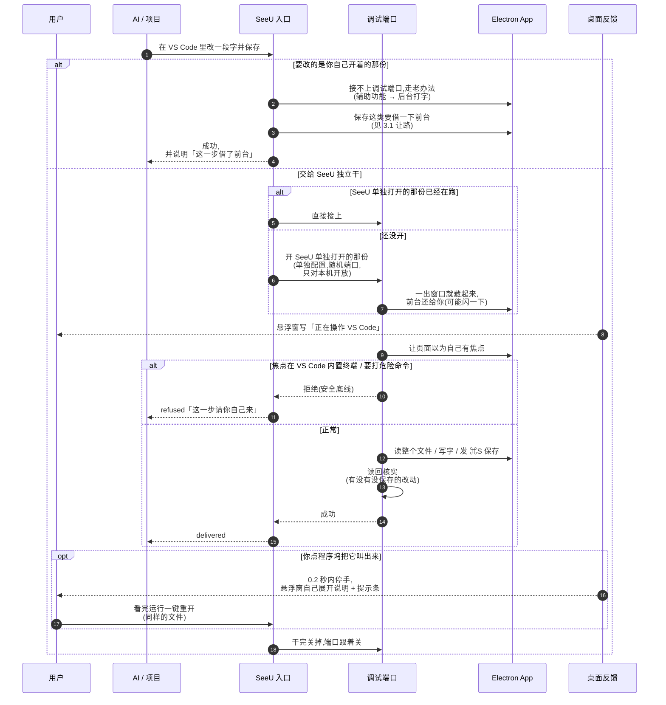

### 3.6 Windows 预览版:点一个按钮

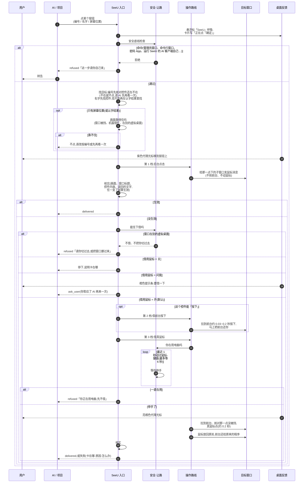

跟 Mac(3.1)的主要不同:Windows 没有私有接口那一档,后台点击是给窗口发消息;中间多一档「借前台按下」,比借真鼠标快、不动鼠标;不用开任何系统授权。

### 3.7 Windows 预览版:网页走后台浏览器

浏览器里不长按、不拖动(这两样按屏幕位置操作,会绕开允许名单),网页上的东西只按编号点。

### 3.8 Linux 预览版:点一个按钮、往框里写字

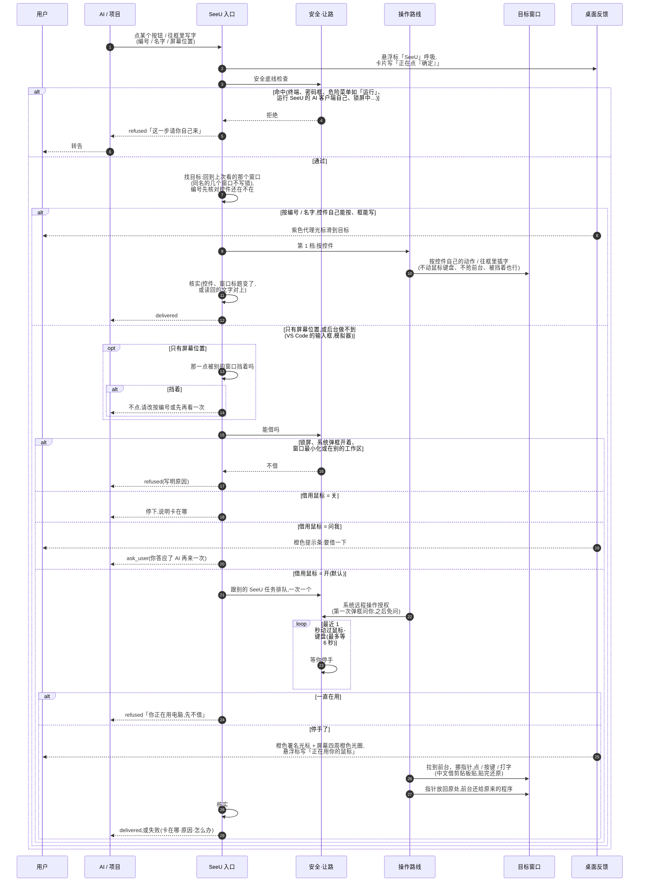

跟 Windows(3.6)的主要不同:Linux 的后台只有「按控件」这一档(不能给窗口发鼠标消息),做不到就直接借真鼠标键盘;借之前要过系统的远程操作授权;锁屏、系统弹框开着时一律不借。

### 3.9 Linux 预览版:网页走后台浏览器

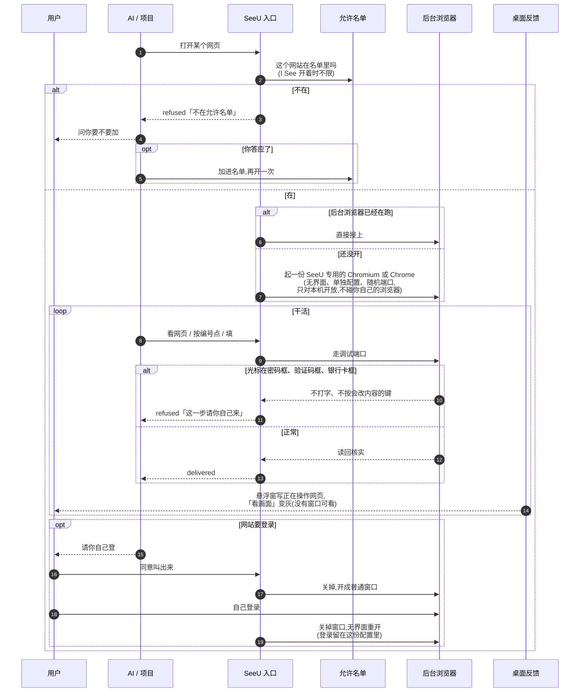

跟 Windows(3.7)一样;不同只在浏览器:Linux 用 Chromium 或 Chrome(Ubuntu 上 snap 版 Chromium 也行)。你自己开着的浏览器 SeeU 只看不动(点、打字、按键、滚动都拒),网页一律交给这份后台浏览器。

## ④ 状态图

### 4.1 隐身浏览器

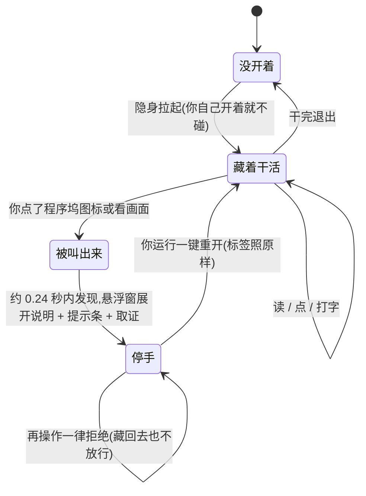

### 4.2 悬浮窗

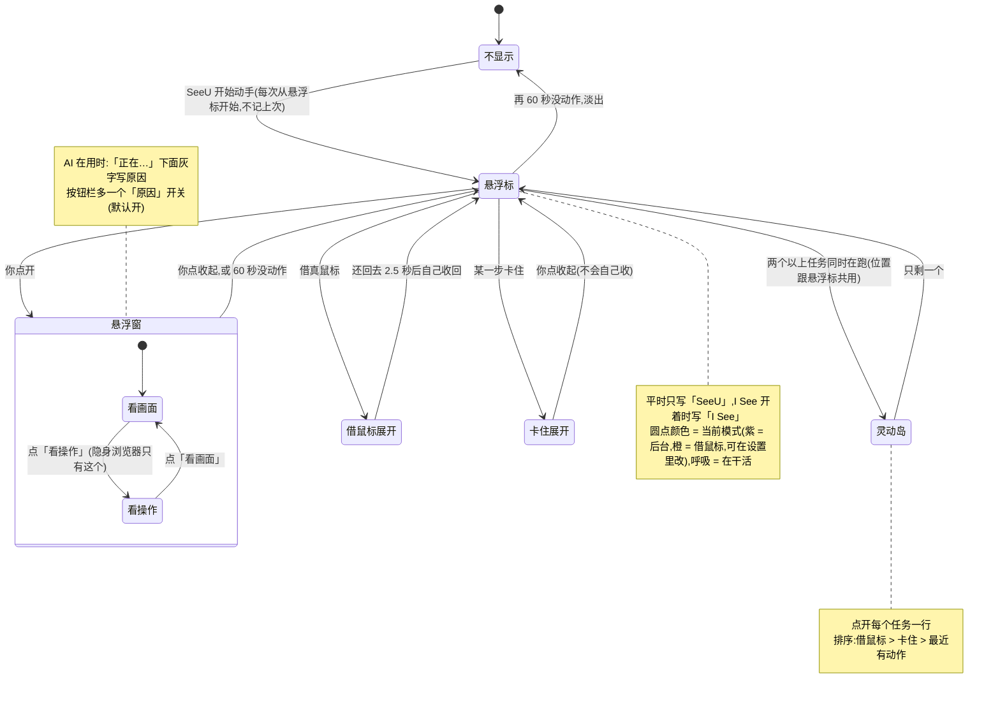

### 4.3 I See(我知风险,授权先做再说)

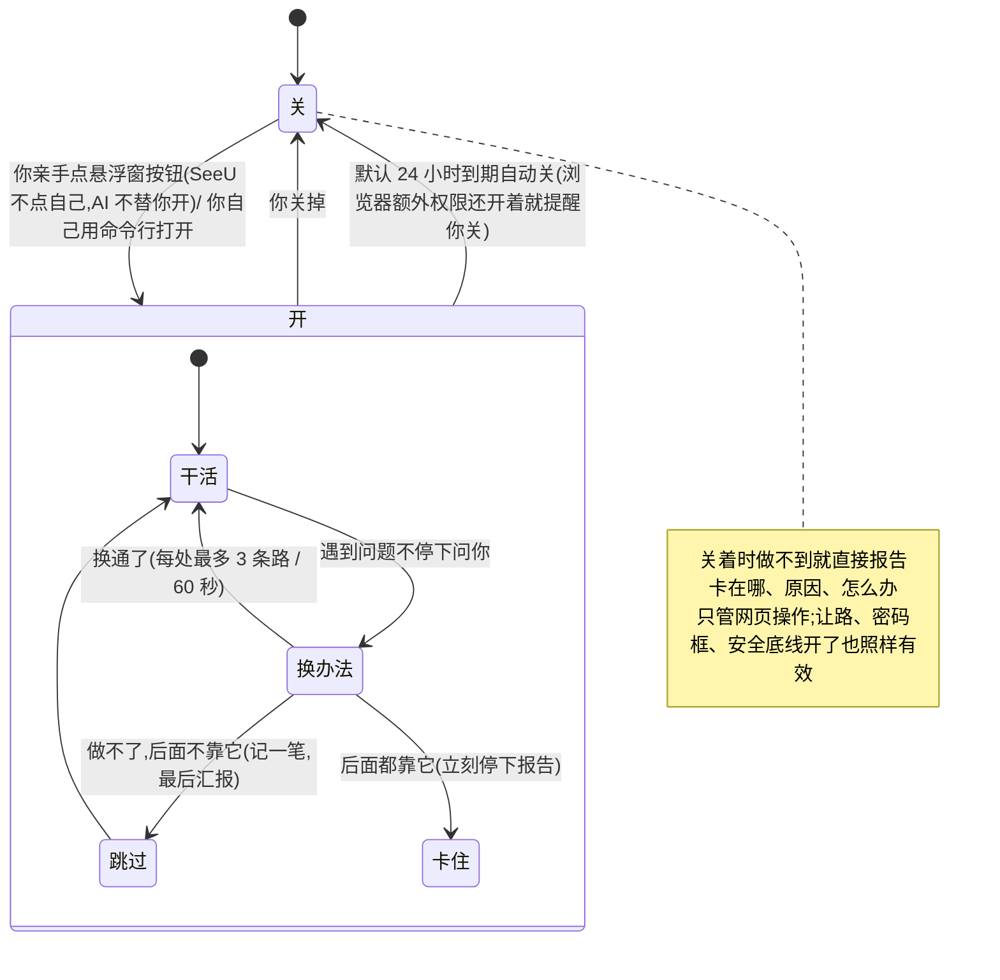

## ⑤ 思维导图

SeeU 能做的全部事情,一张图看完。

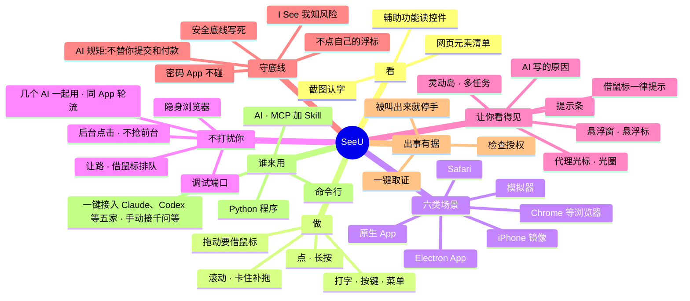
